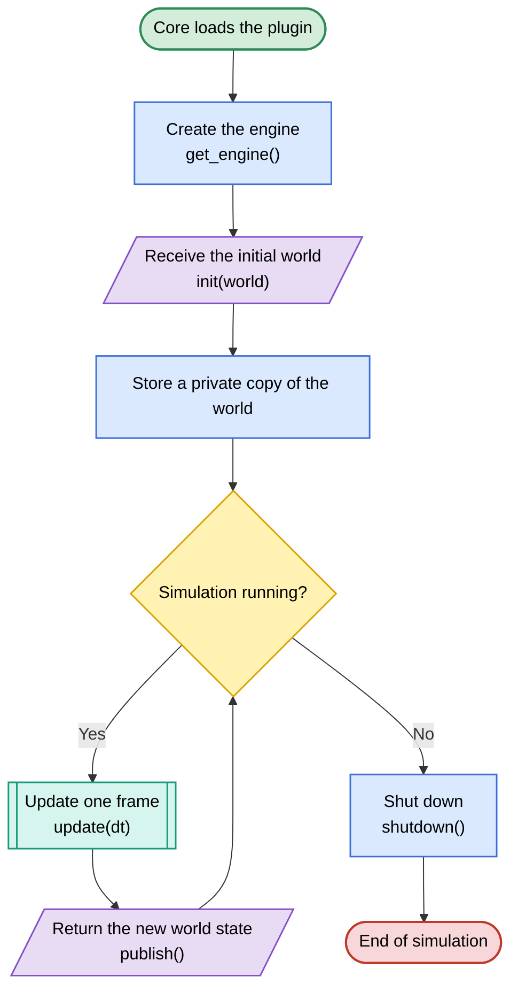
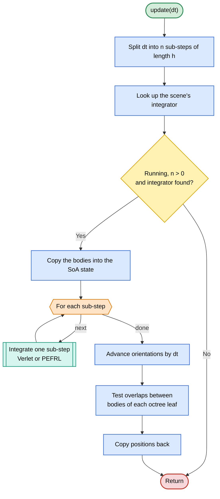
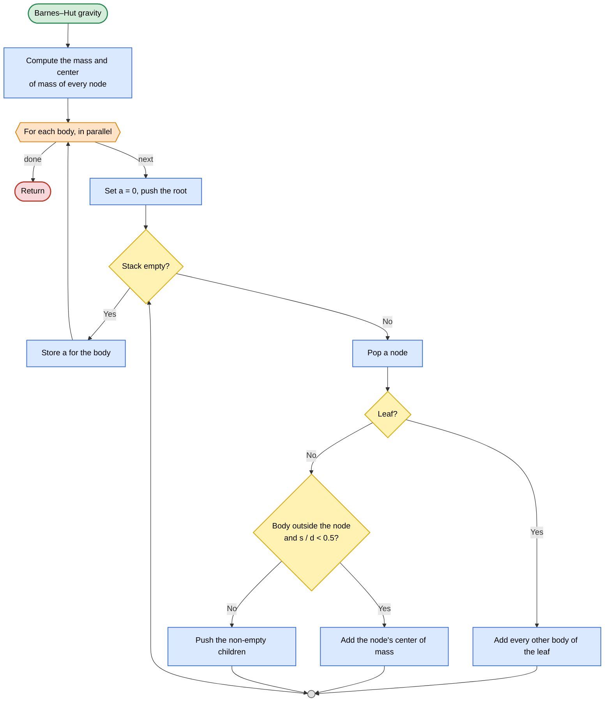

# Physics

N-body gravity module of [OrbitalEngine](https://github.com/VegaCorpo/OrbitalEngine), built as a plugin (`liborbital_physics.so`) that the Core loads at runtime.

It receives a snapshot of the bodies, advances them under Newtonian gravity, and returns their new state. Its only contact with the engine is the `common::IPhysicsEngine` interface from [Common](https://github.com/VegaCorpo/Common).

## Features

- **Gravity**: Barnes–Hut octree, $O(N \log N)$ (default), or SIMD brute force, $O(N^2)$
- **Integrators**: velocity Verlet (order 2) or PEFRL (order 4), both symplectic, chosen per scene
- **Stable time stepping**: any `dt` from Core is split into equal sub-steps of at most 7200 s
- **Rotation** of each body and **contact detection** (sphere overlap)
- **Parallel and isolated**: multithreaded and vectorized, with no shared state with other modules

## Architecture

### Module lifecycle

Core loads the library and drives the module from its own physics thread. The module works on a private copy of the world, so it runs alongside the other modules without locks.

`NewtonianPhysics` implements `common::IPhysicsEngine` and only orchestrates its collaborators (`TimeStep`, `IntegratorCatalog`, `GravityField`, `Collider`). The two extension points are small interfaces: `IIntegrator` (how time advances, implemented by `Verlet` and `Pefrl`) and `IAccelerationField` (where accelerations come from, implemented by `GravityField`).



### Frame update



`dt` is split into $n = \lceil dt / 7200 \rceil$ equal sub-steps. A non-finite or negative `dt` is rejected, and a paused module skips the frame.

### Integrators

Both integrators alternate **drifts** ($\mathbf{x} \mathrel{+}= \mathbf{v}\,\tau$) and **kicks** ($\mathbf{v} \mathrel{+}= \mathbf{a}\,\tau$), each kick using freshly computed gravity:

- **Verlet**: half kick, drift, gravity, half kick. The final accelerations are reused by the next step, so one gravity computation per step.
- **PEFRL** (Omelyan, Mryglod & Folk, 2002): five drifts and four kicks, so four gravity computations per step, for a much smaller error.

$$D(\xi h)\,K\!\left(\tfrac{1-2\lambda}{2}h\right)\,D(\chi h)\,K(\lambda h)\,D\big((1-2(\chi+\xi))h\big)\,K(\lambda h)\,D(\chi h)\,K\!\left(\tfrac{1-2\lambda}{2}h\right)\,D(\xi h)$$

### Gravity

Both solvers compute the softened acceleration, in km, kg and s:

$$\mathbf{a}_i = G \sum_{j \neq i} m_j \, \frac{\mathbf{r}_j - \mathbf{r}_i}{\left(\lVert \mathbf{r}_j - \mathbf{r}_i \rVert^2 + \varepsilon^2\right)^{3/2}}$$

The octree is rebuilt at every gravity computation and reused by the contact detection. Barnes–Hut replaces a node by its center of mass when the node does not contain the body and its size $s$ seen from distance $d$ satisfies $s / d < 0.5$. Each body walks the tree with its own stack, so bodies are processed in parallel.



### Data layout

Common's types are used at the module boundary only. Internally, positions, masses, radii and accelerations are stored as 64-byte aligned arrays (one per axis) padded with zero-mass slots to whole SIMD blocks, so the force kernels vectorize without a remainder loop.

## Build

Requires Linux x86-64 with AVX2, CMake ≥ 3.14 and a C++23 compiler with libstdc++. Dependencies (Common, Eigen, EnTT, Boost, oneTBB) are fetched by CPM.

```sh
cmake -S . -B build -DCMAKE_BUILD_TYPE=Release
cmake --build build -j
```

## Tests

[`tests/`](tests/README.md) validates the module from the outside, the way Core uses it (analytic Kepler orbits, conservation laws, integrator order, determinism, benchmarks), plus unit tests for the octree, collider, integrators and time stepping.
